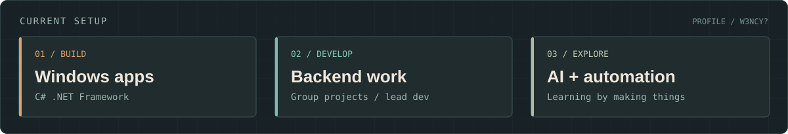
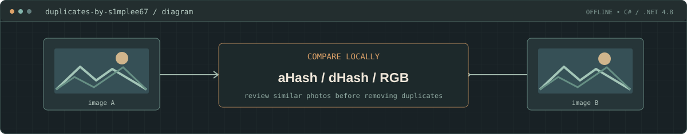
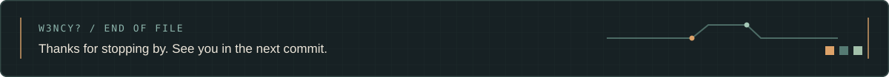

<!-- Profile README | W3NCY? (@S1mplee67) -->

  

  
  
  
  
  

## Hey, I'm W3NCY?

I'm a fourth-year **Computer Engineering** student at **ICCT Colleges, Cainta**. On group projects I'm usually the one working on the backend, putting pieces together, or taking the lead when things need to get finished.

I like making small tools that are actually useful. Right now I'm learning more about **AI and automation** alongside regular development. When I'm not coding, there's a good chance I'm gaming or messing around with a new project idea.

## My workbench

  

I've been spending time on offline desktop software, group project development, and figuring out how to automate repetitive work.

## Selected project

### [Duplicates by S1mplee67](https://github.com/S1mplee67/duplicates-by-s1mplee67)

A Windows app I built for finding duplicate or visually similar photos without uploading them anywhere. It uses **C#**, **.NET Framework 4.8**, and a mix of **dHash, aHash, RGB comparisons, and checksums** to help review possible matches.

  

[View the project and source code](https://github.com/S1mplee67/duplicates-by-s1mplee67)

## GitHub activity

The contribution snake below is generated from my GitHub activity and refreshed automatically.

<picture>
  <source media="(prefers-color-scheme: dark)" srcset="./assets/contribution-snake-dark.svg" />
  <source media="(prefers-color-scheme: light)" srcset="./assets/contribution-snake.svg" />
  
</picture>

  

