<!-- Profile README | W3NCY? (@S1mplee67) -->

  

  
  
  
  
  
  

## Hey, I'm W3NCY?

I'm a fourth-year **Computer Engineering** student at **ICCT Colleges, Cainta**. On group projects I'm usually the one working on the backend, putting pieces together, or taking the lead when things need to get finished.

I like making small tools that are actually useful. Right now I'm learning more about **AI and automation** alongside regular development. When I'm not coding, there's a good chance I'm gaming or messing around with a new project idea.

## My workbench

  

I've been spending time on offline desktop software, group project development, and figuring out how to automate repetitive work.

## Projects

### [5 F!NGERS — Typing & Code Trainer](https://github.com/S1mplee67/5-fingers)

I recently published **5 F!NGERS**, an offline typing trainer that pairs touch-typing lessons with programming syntax practice. It has a visual finger guide and a 75% keyboard layout, ten progressive learning stages, and local tracking for speed and accuracy.

It's built with **HTML, CSS and vanilla JavaScript**, with a small **C# Windows launcher**. No sign-in or cloud connection is needed to practice.

  

[Explore 5 F!NGERS on GitHub](https://github.com/S1mplee67/5-fingers)

### [Duplicates by S1mplee67](https://github.com/S1mplee67/duplicates-by-s1mplee67)

A Windows app I built for finding duplicate or visually similar photos without uploading them anywhere. It uses **C#**, **.NET Framework 4.8**, and a mix of **dHash, aHash, RGB comparisons, and checksums** to help review possible matches.

  

[View the project and source code](https://github.com/S1mplee67/duplicates-by-s1mplee67)

## A little farm between commits

My GitHub contributions, reimagined as a tiny retro farm. Each cow marks a day I contributed code. The UFO is just passing through.

**34 contributions across four days**, based on my public contribution calendar on **October 13, 2026**. This is a snapshot; GitHub's actual contribution graph remains live.

<picture>
  <source media="(prefers-color-scheme: dark)" srcset="./assets/contribution-farm.svg" />
  <source media="(prefers-color-scheme: light)" srcset="./assets/contribution-farm-light.svg" />
  
</picture>

  

