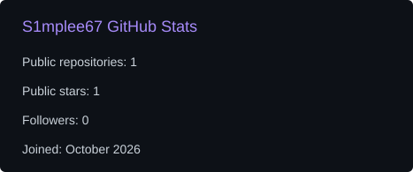
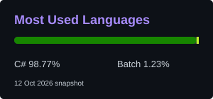

<!-- GitHub profile README for S1mplee67 -->

## Hello, world!

I'm **SIkeeeMODDER** ([@S1mplee67](https://github.com/S1mplee67)). I build Windows utilities and explore practical image-analysis tools with **C#**, **.NET**, and offline-first software.

**ANTIGRAVITY!!**

| Windows utilities | Image analysis | Practical tools |
| :--- | :--- | :--- |
| Desktop software and local workflows | Perceptual hashing and duplicate detection | Everyday tools with no cloud upload requirement |

## Tools & technologies

## Featured project

**[Duplicates by S1mplee67](https://github.com/S1mplee67/duplicates-by-s1mplee67)** — a local Windows desktop app for finding duplicate and visually similar photos, even when images have been resized or recompressed.

Built with **C# / .NET Framework 4.8**, using dHash, aHash, RGB comparisons and checksums.

## GitHub snapshot

## 🐍 Contribution Snake

Watch the snake travel across my real GitHub contributions. Updated automatically with GitHub Actions.

<picture>
<source media="(prefers-color-scheme: dark)" srcset="./assets/contribution-snake-dark.svg"/>
<source media="(prefers-color-scheme: light)" srcset="./assets/contribution-snake.svg"/>

</picture>

Code × Build × Explore · Stay curious
